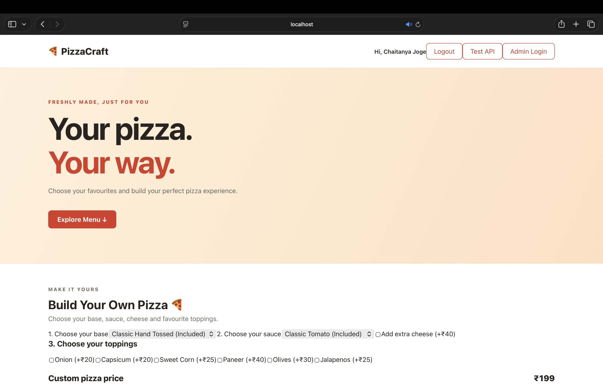
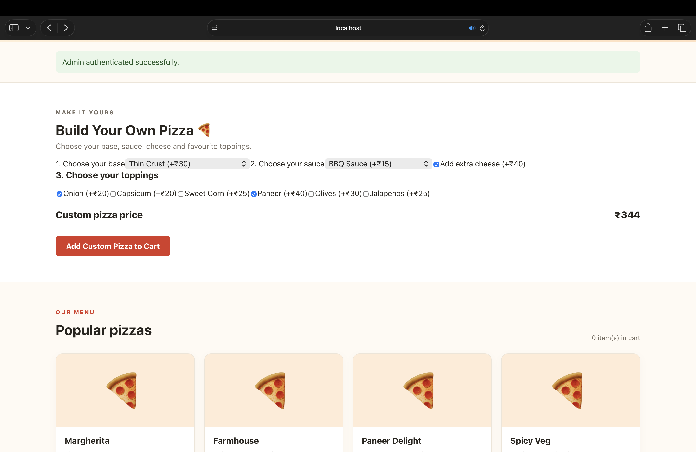
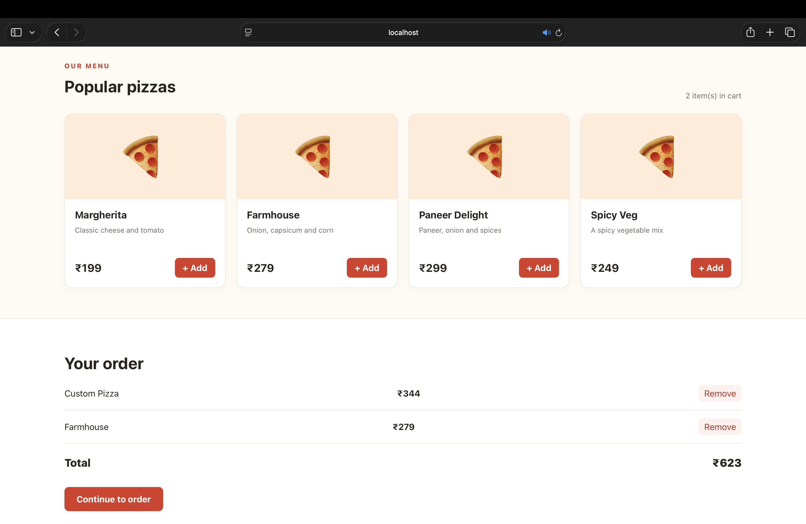
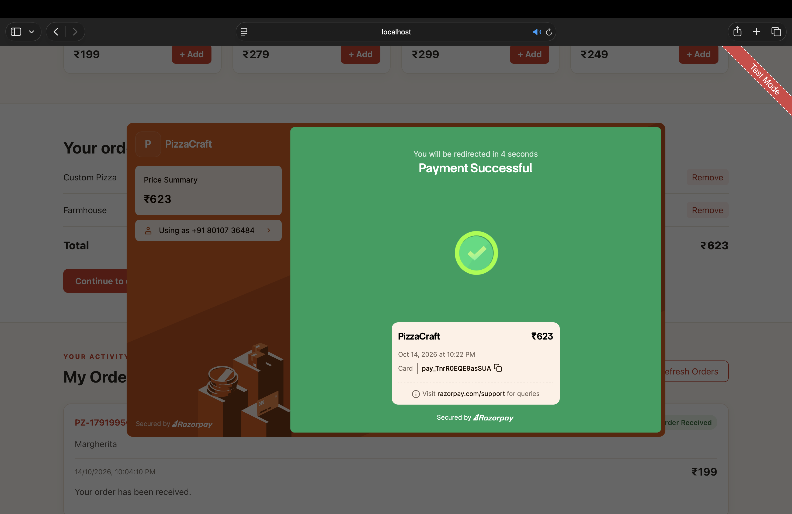
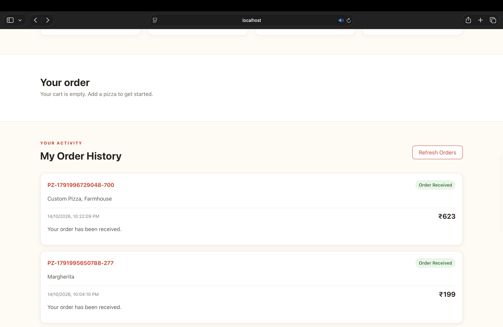
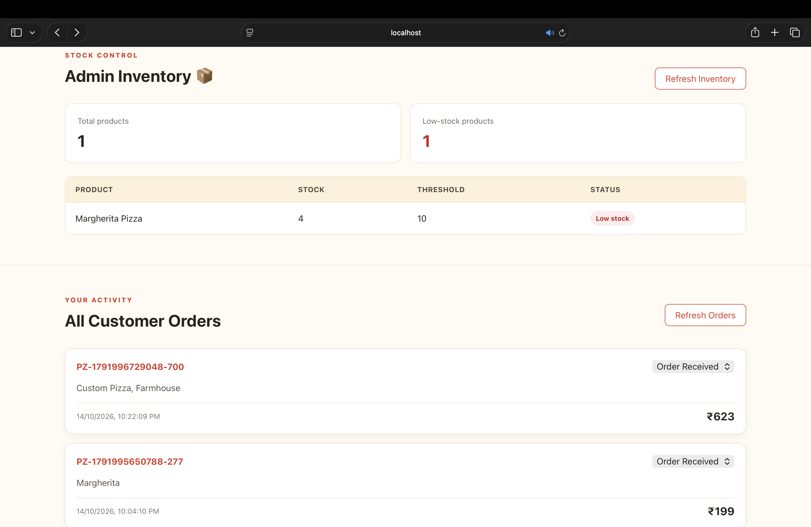

# PizzaCraft — Full-Stack Pizza Delivery Application

A full-stack pizza ordering application developed as part of the **Oasis Infobyte Web Development & Designing Internship — Level 3**.

PizzaCraft lets customers browse a pizza menu, build custom pizzas, manage their cart, complete test payments through Razorpay, and view order history. Administrators can manage orders, update order statuses, and monitor inventory.

## Features

### Customer
- Browse the pizza menu and prices.
- Build custom pizzas using different bases, sauces, cheese, and toppings.
- Add pizzas to the cart and calculate the order total.
- Complete checkout using Razorpay Test Mode.
- Save orders to MongoDB after payment verification.
- Register and log in to a customer account.
- View order history and order status.

### Administrator
- Admin login with JWT-based authentication.
- View customer orders.
- Update order statuses.
- View inventory quantities and low-stock indicators.
- Update inventory through protected backend operations.

### Payment
- Razorpay test checkout integration.
- Server-side order amount calculation.
- Payment signature verification.
- Payment status checks during verification.
- Orders are finalized through the payment verification flow.

**Note:** Payments are for testing and demonstration only. No real payment should be made through test credentials.

## Technology Stack

- **Frontend:** React, Vite, Axios, CSS
- **Backend:** Node.js, Express
- **Database:** MongoDB Atlas, Mongoose
- **Authentication:** JSON Web Tokens (JWT), bcryptjs
- **Payment Gateway:** Razorpay Test Mode
- **Version Control:** Git and GitHub

## Screenshots

### 1. Home Page


### 2. Custom Pizza Builder


### 3. Menu and Checkout


### 4. Razorpay Test Payment Success


### 5. Customer Order History


### 6. Admin Orders and Inventory


## Project Structure

```text
WebDev-L3-PizzaDelivery/
├── client/
│   ├── src/
│   ├── package.json
│   └── vite.config.js
├── server/
│   ├── index.js
│   ├── Order.js
│   ├── Admin.js
│   ├── createAdmin.js
│   ├── package.json
│   └── .env.example
├── screenshots/
├── .gitignore
└── README.md
```

## Prerequisites

- Node.js and npm
- A MongoDB Atlas database or compatible MongoDB instance
- Razorpay Test Mode API credentials

## Installation and Setup

### 1. Clone the repository

```bash
git clone https://github.com/ChaitanyaJoge/OIBSIP.git
cd OIBSIP/OIBSIP/WebDev-L3-PizzaDelivery
```

### 2. Configure the backend

```bash
cd server
npm install
```

Create a `.env` file in the `server` directory using `.env.example` as a reference. Configure the variables required by your application, including:

```env
MONGODB_URI=your_mongodb_connection_string
PORT=5001
JWT_SECRET=your_long_random_secret
ADMIN_EMAIL=your_admin_email
ADMIN_PASSWORD=your_admin_password
RAZORPAY_KEY_ID=your_razorpay_test_key_id
RAZORPAY_KEY_SECRET=your_razorpay_test_key_secret
```

Use your actual variable names from `.env.example` if they differ. Use only Razorpay test keys for local testing. Never commit `.env` or expose secret values.

### 3. Start the backend

```bash
npm run dev
```

The API should run at `http://localhost:5001`.

Check the health endpoint:

```bash
curl http://localhost:5001/api/health
```

### 4. Start the frontend

Open a second terminal:

```bash
cd client
npm install
npm run dev
```

Open the local URL printed by Vite, usually `http://localhost:5173`. If that port is occupied, use the alternative port displayed in the terminal.

## API Endpoints

| Method | Endpoint | Purpose |
|---|---|---|
| GET | `/api/health` | Check API health |
| POST | `/api/customers/register` | Register a customer |
| POST | `/api/customers/login` | Customer login |
| POST | `/api/admin/login` | Administrator login |
| GET | `/api/orders` | Retrieve orders with administrator authorization |
| GET | `/api/customers/orders` | Retrieve the authenticated customer's orders |
| PATCH | `/api/orders/:id/status` | Update an order's status |
| POST | `/api/payments/create-order` | Create a Razorpay payment order |
| POST | `/api/payments/verify` | Verify a Razorpay payment |
| GET | `/api/inventory` | Retrieve inventory |
| PUT | `/api/inventory/:name` | Update inventory |

Protected endpoints require the appropriate authentication.

## Testing

The following have been exercised during local development:

- Customer login and order history
- Custom pizza selection and cart total calculation
- Razorpay test checkout and successful test payment
- MongoDB connectivity and order persistence
- Administrator order management and inventory display

These checks are manual demonstrations, not an automated test suite.

## Security Notes

- Keep `.env` and all credentials private.
- Never use live payment keys for a demonstration.
- Restrict MongoDB Atlas network access to trusted IP addresses.
- Use strong JWT secrets and keep administrator credentials private.
- Review authorization, input validation, CORS, and error handling before public production deployment.

## Known Limitations

- Email verification and forgot-password email workflows have not been confirmed as implemented.
- Automated scheduled low-stock email alerts have not been confirmed as implemented.
- Real payment processing and production deployment are outside the scope of this test-mode demonstration.

## Internship Submission

- **Program:** Oasis Infobyte Internship
- **Track:** Web Development & Designing
- **Task:** Level 3 — Pizza Delivery Full-Stack Application
- **Repository:** https://github.com/ChaitanyaJoge/OIBSIP
